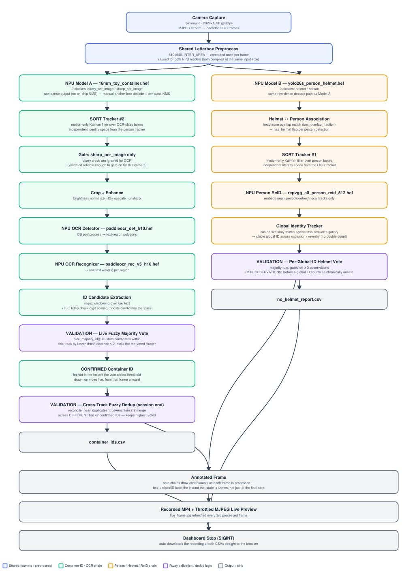

# Industrial Edge Vision Dashboard — Container OCR + PPE Detection + Person Re-ID (Raspberry Pi + Hailo NPU)

Live, on-device industrial vision on a Raspberry Pi: two Hailo NPU detectors,
PaddleOCR (det + rec), and person re-identification run concurrently on a
single Hailo device, with results burned into the video and CSVs as they
happen and viewed from a browser dashboard. `16mm_toy_container.hef` finds
container-ID text crops (blurry vs. sharp), `yolo26s_person_helmet.hef` finds
people and helmets, and everything else — tracking, helmet association,
identity resolution, ID voting — runs live on top of that.



This is a pivot from an earlier single 4-class combined model. That model
needed real ONNX graph surgery to force on-chip NMS onto it in the first
place, and even with that working structurally, live testing on the Pi
showed it detecting almost nothing on clearly legible content. Two separate
2-class models sidestep the actual root cause (Hailo's shape-based NMS
auto-detection breaks when class count numerically equals the box-regression
channel count — 4, for this architecture — and 2 never collides with 4),
so both hefs compiled clean, no hacks, first try.

Beyond the dual-model split, this version adds three correctness fixes found
during live testing on real hardware:

- **Person head/body dedup.** `yolo26s_person_helmet.hef`'s training data
  boxed both a head-scale region and a full-body region as class "person"
  for the same physical target — left unfiltered, that mints two SORT
  tracks (and two ReID gallery entries) per real person. A dedup pass
  (`filter_head_scale_person_boxes`) keeps only the head/face-scale box per
  target as the canonical detection for tracking/counting/helmet-matching
  (using aspect ratio, containment, and IoU-overlap heuristics to identify
  and suppress the duplicate body box), while still cropping the paired
  body region for the actual ReID embedding, since ReID wants a whole-body
  crop.
- **Retuned SORT thresholds.** `SORT_MAX_AGE` raised 30 → 45 and
  `SORT_IOU_THRESHOLD` loosened 0.3 → 0.2 so a track survives erratic
  motion (e.g. a fast head turn) instead of being dropped and re-created as
  a new local id — which is what previously forced the ReID identity
  resolver to re-run its whole decision from scratch on every drop.
- **ISO 6346 container check-digit validation.** OCR'd container-ID
  candidates are checked against the real ISO 6346 mod-11 checksum, not
  just OCR confidence — a candidate whose trailing digit matches the
  computed check digit gets a large scoring bonus, since a wrong OCR read
  matching the checksum by chance is unlikely. A track's ID needs far fewer
  corroborating reads to finalize once one of them has actually validated
  against the checksum (1 vote) versus relying on repetition alone (3
  votes).

The person-ReID engine (`reid_engine.py`) also grew a second, periodic
consistency pass over the whole identity gallery: any two "different"
identities whose accumulated embeddings cross-match well are folded back
into one, catching cases where a single noisy real-time match split one
real person into two counted identities.

## What's in this folder

| File | Purpose |
|---|---|
| `combined_live_pi.py` | Main pipeline, reads the live camera |
| `combined_video_file_pi.py` | Same pipeline, reads pre-recorded videos from `input_videos/` |
| `dashboard.py` | NiceGUI browser dashboard — Start/Stop, live preview, auto-downloads results |
| `reid_engine.py` | Hailo person ReID wrapper + stable-identity tracker (gallery matching, adaptive blur gating, duplicate-identity merge pass) |
| `run_dashboard.sh` | One Pi-side script: driver check, venv setup, NPU self-test, launch |
| `requirements.txt` | Pip deps (opencv/numpy/hailo_platform come from the system, not pip) |
| `launch_remote.ps1` / `pi_config.ps1` | PC-side PowerShell launcher (SSH, no key setup) |
| `16mm_toy_container.hef` | Container-ID crop detector (blurry_ocr_image, sharp_ocr_image) |
| `yolo26s_person_helmet.hef` | Person/helmet detector |
| `paddleocr_det_h10.hef`, `paddleocr_rec_v5_h10.hef`, `ppocrv5_dict.txt` | OCR det + rec + character dictionary |
| `docs/` | Architecture diagrams referenced in this README |
| `sample_output/` | Small representative CSVs showing the pipeline's real output format (the actual annotated-recording/session output is not included here — see below) |

> **Note on `sample_output/`:** a full session's raw output (annotated MP4
> recordings, embedding dumps) runs from tens to hundreds of MB per run, so
> it isn't checked into this repo. `sample_output/container_ids.csv` and
> `sample_output/no_helmet_report.csv` are copied as-is from a real test
> session purely to show the output schema.

## First time on a new Pi/laptop

**On the Pi:** nothing to install by hand. Just run:
```bash
bash run_dashboard.sh
```
It detects your Hailo chip (Hailo-8 vs Hailo-10H) via `lspci`, installs the
matching apt driver package if it's missing or wrong, creates/repairs the
venv with `--system-site-packages` (needed so `hailo_platform`, `cv2`, and
`numpy` — none of which are pip-installable in this setup — are visible
inside it), installs `requirements.txt`, does a real NPU self-test (opens
and releases a `VDevice`), then launches the dashboard on port 8000. If the
driver package had to change, it exits after installing and asks for
`sudo reboot` once — a real kernel driver reload, unavoidable — then run
the same command again to finish.

**On your PC:** edit `pi_config.ps1` with your Pi's `user@ip` (replace the
`YOUR_PI_IP` placeholder), the folder path on the Pi, and (if you changed
it) the venv name, then:
```powershell
.\launch_remote.ps1
```
This SSHes in (plain password prompt, no key setup), runs `run_dashboard.sh`
on the Pi detached so it survives the SSH session closing, waits for the
dashboard to come up, and opens it in your browser. `stop`, `status`, and
`reboot` subcommands are also available — see the comment header in
`launch_remote.ps1`.

**One resource `run_dashboard.sh` can't fetch for you:** person re-ID needs
`repvgg_a0_person_reid_512.hef` at
`/usr/local/hailo/resources/models/hailo10h/` on the Pi. It isn't part of
this repo and isn't installed by any apt package (checked directly with
`dpkg -S` — nothing owns that path), so on a Pi that's never had it placed
there, `reid_engine.py` will silently degrade to tracker-only counting (no
crash, no clear warning unless you check `dashboard.log`). If you have a
Pi that already has the file, copy it to each new Pi once:
```bash
ssh <new-pi> "sudo mkdir -p /usr/local/hailo/resources/models/hailo10h"
scp /usr/local/hailo/resources/models/hailo10h/repvgg_a0_person_reid_512.hef \
    <new-pi>:/usr/local/hailo/resources/models/hailo10h/
```
(the second `scp` will itself need write access to that directory —
`ssh <new-pi> "sudo chown $(whoami) /usr/local/hailo/resources/models/hailo10h"`
first if it complains, or `scp` as root). Do this before your first
`run_dashboard.sh` run on that Pi.

## One important caveat

`hailortcli parse-hef 16mm_toy_container.hef` (run on real Pi hardware,
which is the only way to know for sure) shows this hef compiles to 6 raw
outputs — 3 box heads + 3 class heads across strides 8/16/32 — not one
fused on-chip-NMS output, despite compiling cleanly and despite earlier
dev-machine `.har` inspection suggesting otherwise. `HailoBoxDetector` in
`combined_live_pi.py` handles this automatically: it detects the multi-output
case and does a manual anchor-free decode (matching l/t/r/b distances per
grid cell, sigmoid, per-class NMS via `cv2.dnn.NMSBoxes`) so the rest of the
pipeline never has to know or care which kind of hef it's looking at. If you
ever recompile either hef, don't assume it has real on-chip NMS without
checking `hailortcli parse-hef` yourself first — the dev-machine SDK-side
`.har` inspection that originally suggested it did was misleading.

Quantization quality differs between the two hefs: `16mm_toy_container.hef`
is calibration-only (Adaround was blocked by a GPU driver issue on the dev
machine at the time). `yolo26s_person_helmet.hef` is the full Adaround
build (ran ~1 day, CPU-only, no GPU needed once given enough calibration
images) — if person/helmet accuracy and container-ID accuracy look
noticeably different from each other, this quantization difference is the
first thing to suspect, separately from the NMS issue above.

## Latency optimizations already applied

- Both detectors share one letterboxed input per frame (both compiled at
  640x640) instead of resizing the full frame twice.
- `default_preprocess`'s downscale uses `INTER_AREA` instead of
  `INTER_CUBIC` — cheaper and the more correct choice for every current
  (shrinking) call site, not a tradeoff.
- The raw-dense decode path's per-scale grid-center coordinates are
  precomputed once at detector init instead of rebuilt with `np.meshgrid`
  every frame.
- The dashboard's live preview (`live_frame.jpg`) is written every 3rd
  frame instead of every frame — the browser poll is far coarser than that
  anyway.

See the top-of-file docstring in `combined_live_pi.py` for the full
rationale on each, plus two bigger, riskier optimizations deliberately left
untried without real hardware to verify against: switching the Hailo
`.run()` calls to the async `run_async()` API so NPU and CPU work overlap,
and frame-skipping person/helmet detection every other frame (SORT already
tolerates gaps). Both are reasonable things to try and measure at the Pi.

## Testing before you're sure everything's wired up

**Option A — dashboard, live camera (recommended, matches real usage):**
```bash
bash run_dashboard.sh
```
then open `http://<pi-ip>:8000` (or just run `.\launch_remote.ps1` from the
PC, which does this for you and opens the browser automatically). Click
Start, let it run, click Stop — the annotated recording and both CSVs
download automatically.

**Option B — pre-recorded video, no camera/dashboard needed:**
```bash
source myenv_combined_dashboard/bin/activate   # or your venv name
mkdir -p input_videos
# copy .mp4/.avi/.mov/.mkv files into input_videos/
python3 combined_video_file_pi.py
```
Outputs land in `video_outputs/`: one annotated video + two CSVs per input
video, plus a `summary.csv` across all of them.

## Using the dashboard

Open `http://<pi-ip>:8000`. Click **Start** to begin a live session (camera
turns on, live preview streams in the browser, running people/no-helmet/
container-ID counts update once a second). Click **Stop** to end it
gracefully (SIGINT, same as Ctrl+C at a terminal) — once it finishes writing
the recording and CSVs, your browser automatically downloads
`annotated_recording.mp4`, `container_ids.csv`, and `no_helmet_report.csv`.
See `sample_output/` in this repo for what those two CSVs look like.

## Testing against pre-recorded video instead of the live camera

See Option B above. Runs the identical pipeline logic (imported from
`combined_live_pi.py`, not reimplemented) against files instead of the
camera — useful for repeatable before/after comparisons when tuning
thresholds, since the same clip gives the same input every time.

## If something looks wrong

- **`run_dashboard.sh` exits asking for a reboot:** expected the first time
  the Hailo driver package changes. Run `sudo reboot`, then run
  `bash run_dashboard.sh` (or `.\launch_remote.ps1` from the PC) again —
  it won't ask again after that.
- **`start` from the PC never comes up:** `launch_remote.ps1` automatically
  tails the Pi's `dashboard.log` when this happens — read that first. If it
  shows a Hailo NPU error, SSH in and run `bash run_dashboard.sh` directly
  once (it needs a real terminal to prompt for `sudo`, which a detached
  `start` can't provide).
- **Container IDs look wrong / missing / mismatched:** check the
  quantization-quality caveat above — `16mm_toy_container.hef` is
  calibration-only, so this is the more likely detector to misbehave on
  edge cases (glare, unusual angles, partial occlusion) than the person/
  helmet model. A candidate that never validates against the ISO 6346
  check digit falls back to requiring more repeated corroborating reads
  before it's finalized.
- **No-helmet counts look inflated or a person is double-counted:** confirm
  `repvgg_a0_person_reid_512.hef` actually exists at
  `/usr/local/hailo/resources/models/hailo10h/` on this Pi —
  `reid_engine.py` silently degrades to tracker-only identity (no ReID
  correction) if it's missing, which prints a `[WARN]` at startup you can
  check `dashboard.log` for. Also check the console for
  `[ReID] gallery self-check: merged duplicate identity` lines — that's the
  periodic gallery-consistency pass catching and fixing a split identity
  after the fact.
- **Only container-ID detection runs, no person/helmet boxes at all:**
  `yolo26s_person_helmet.hef` wasn't found next to the script — check
  `dashboard.log` for the `[WARN] ... not found` line. Drop the file in and
  restart; no code changes needed.

## Architecture

See `docs/architecture_diagram.jpeg` and
`docs/combined_dashboard_pi_architecture.png` for the end-to-end data flow —
camera → dual Hailo detectors → OCR/ReID → tracking/voting → dashboard.

## Project History

This system went through several iterations before reaching the
architecture in this repo. It started as an OCR-only pipeline running
entirely on CPU, then moved to a fully Hailo-accelerated OCR pipeline once
the NPU toolchain was in place. From there it became a combined OCR + PPE
system running on CPU-based ONNX models to prove out the joint pipeline
logic, followed by an attempt at a single combined 4-class Hailo model that
had to be abandoned after ONNX graph surgery and live testing showed it
detecting almost nothing. The final architecture here is the result of that
process: each step was driven by a concrete failure mode found on real
hardware, not a redesign for its own sake.

## Acknowledgements

This project was developed under the supervision of
**Dr. Ahmad Sufril Azlan Mohamed** ([@DrSufril](https://github.com/DrSufril)),
School of Computer Sciences, Universiti Sains Malaysia (USM).
I am grateful for his guidance and support throughout the research and development of this work.
